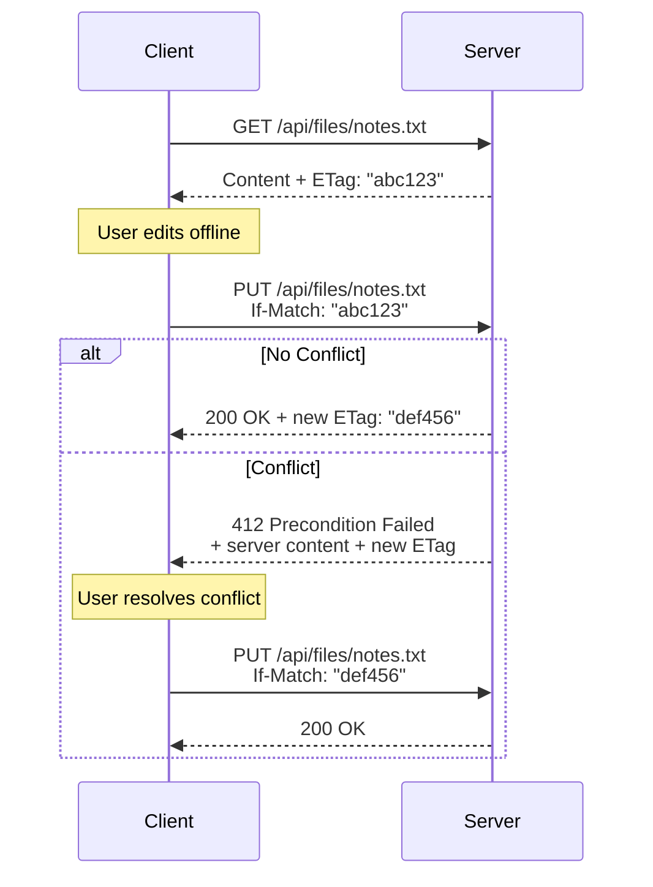

# Plain Text File Server

A lightweight REST API server for reading, writing, and managing plain text files on a host system. Content-agnostic file operations with optimistic concurrency control via ETags.

**Status: Experimental**

## TL;DR

Node.js server that exposes text files via REST API. Designed to work with web frontends and file synchronization tools like Syncthing or Git. Uses JWT authentication and ETags for conflict detection when multiple clients edit the same files.

## What It Is

A simple HTTP server that treats text files as remote resources. You can CRUD text files (`.txt`, `.md`, `.json`, etc.) over HTTP with authentication and security rules. The server doesn't parse or understand file contents—it just stores and retrieves raw text.

## Primary Use Case

**Web frontend + file backend**

- Run this server on a machine that stores your text files
- Access files from web applications running on other devices
- Use file synchronization (Syncthing, Git, etc.) to keep files consistent across multiple servers
- Build web apps for todo lists, notes, logs, etc. that store data as plain text files

**Example setup:**
```
Laptop (Syncthing) ←→ Home Server (plain-text-file-server) ←→ Phone Web App
```

## How It Works

### ETag-based Concurrency Control

The server uses SHA-1 hashes as ETags to detect concurrent modifications:

1. **Read**: Client requests file, receives content + ETag header
2. **Write**: Client sends update with `If-Match: "<ETag>"` header
3. **Conflict**: If file changed on server since read, server returns `412 Precondition Failed` with current content and ETag
4. **Resolution**: Client displays conflict to user, who merges changes, then retries with new ETag

### Client Interaction Pattern



### Atomic Writes

File modifications use temporary files with atomic rename:
- Write to `file.txt.tmp.<random>`
- Rename to `file.txt` (atomic operation)
- Prevents partial writes if process crashes during write

## Security

### Authentication

- JWT tokens with configurable secret and expiry
- Bcrypt-hashed passwords stored in config
- Rate-limited login endpoint (5 attempts per 15 minutes per IP)
- Tokens include user role and allowed subdirectories

### CORS

- CORS enabled for development (allows all origins)
- ETag header explicitly exposed for cross-origin requests
- **Production**: Configure CORS to allow only specific domains

### Security Considerations

- Binds to `127.0.0.1` by default—use reverse proxy (Caddy, Nginx) or Tailscale for public access
- HTTPS/TLS termination should be handled by reverse proxy
- JWT secret must be changed from default in production
- Path traversal protection prevents access outside storage directory
- File extension whitelist and glob patterns restrict accessible files
- Dotfile filtering (configurable) prevents access to hidden files

### Limitations

- No built-in encryption—files stored as plain text
- No audit logging of file operations
- No file versioning—use Git or external backup
- No user-specific file permissions—all users share same file access
- No compression or deduplication
- Maximum file size configurable (default 10MB)

## How NOT to Use It

- **Don't** store sensitive data without encryption at rest
- **Don't** expose directly to internet without reverse proxy and HTTPS
- **Don't** use for binary files (images, PDFs, etc.)
- **Don't** expect enterprise features (auditing, RBAC, etc.)
- **Don't** use as a general-purpose file server (no access to all file types)

## API Endpoints

### Authentication

**POST /api/login**
```json
{
  "username": "admin",
  "password": "your_password"
}
```
Returns JWT token for subsequent requests.

### File Operations

All file endpoints require `Authorization: Bearer <token>` header.

**GET /api/files** - List all accessible files
**GET /api/files/*path** - Read file content (returns ETag header)
**PUT /api/files/*path** - Create/update file (requires If-Match for updates)
**DELETE /api/files/*path** - Delete file (optional If-Match)
**POST /api/move** - Move/rename file

See [DESIGN.md](DESIGN.md) for complete API specification.

## Setup

1. Install dependencies: `npm install`
2. Generate password hash: `npm run generate-hash <password>`
3. Update `config.json` with your JWT secret and user credentials
4. Create storage directory: `mkdir storage`
5. Start server: `npm start`

## Configuration

Edit `config.json`:

```json
{
  "server": {
    "port": 3000,
    "host": "127.0.0.1",
    "storageDir": "./storage"
  },
  "auth": {
    "jwtSecret": "CHANGE_THIS_SECRET",
    "tokenExpiryDays": 30,
    "users": [...]
  },
  "rules": {
    "ignoreDotfiles": true,
    "maxFileSizeMb": 10,
    "allowedExtensions": [".txt", ".md", ".json", ...],
    "excludePatterns": ["**/node_modules/**", ...],
    "readOnlyPatterns": ["**/archive/**", ...]
  }
}
```

## Example Client

See the [example-client](example-client/) directory for a local development tool that demonstrates authentication and API interaction. Since this is a dynamic API server, the example client is intended for local testing and development only—you'll need to run the server instance to use it.

## License

MIT
